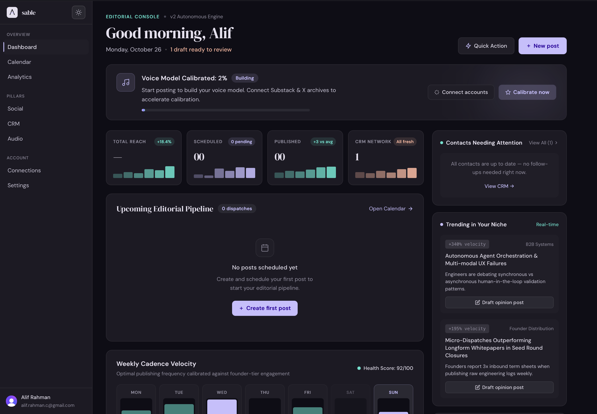
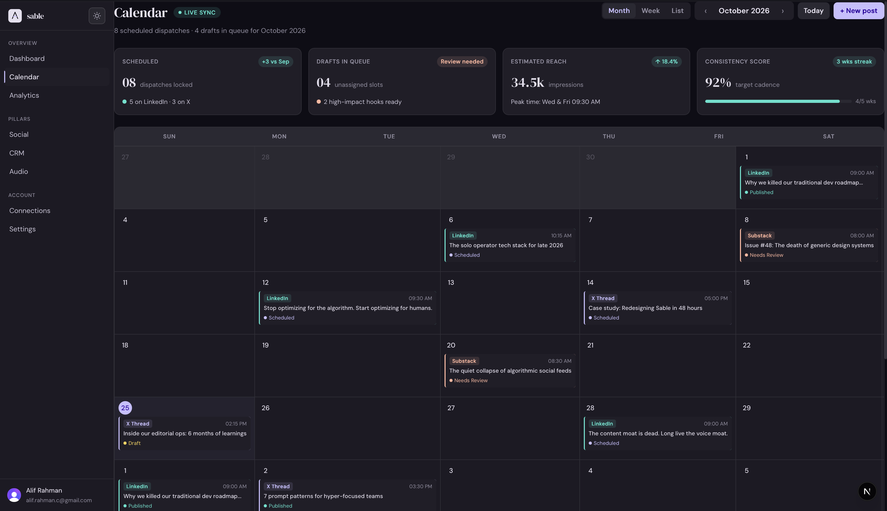
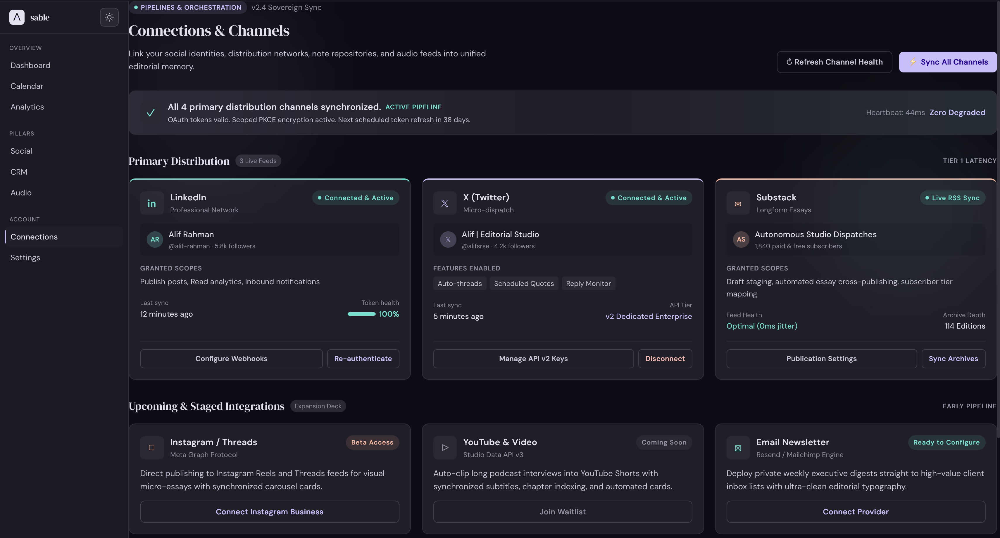
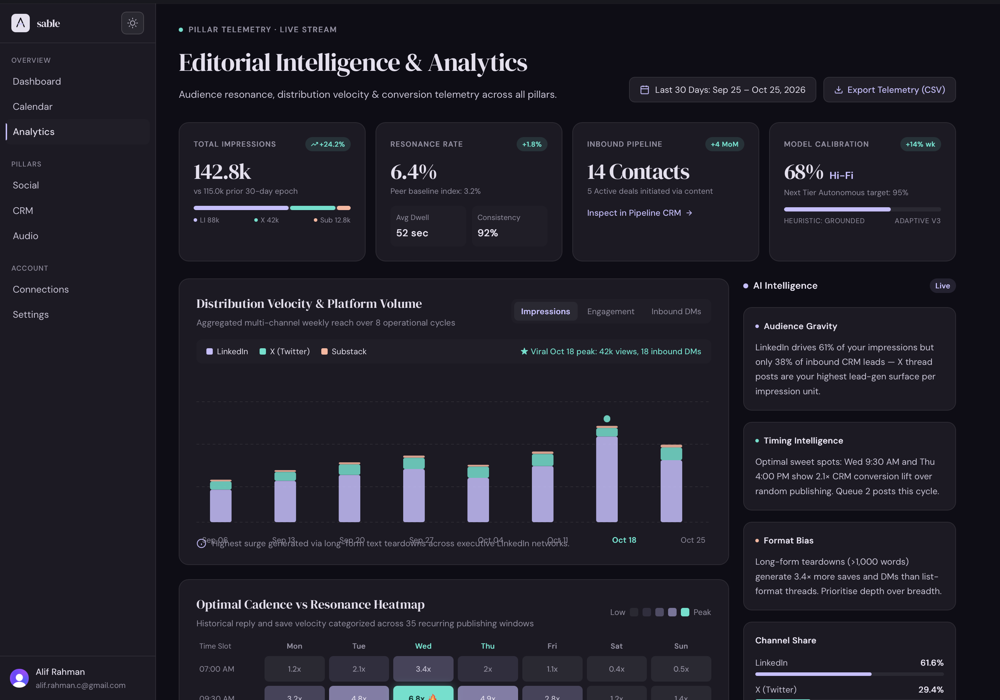
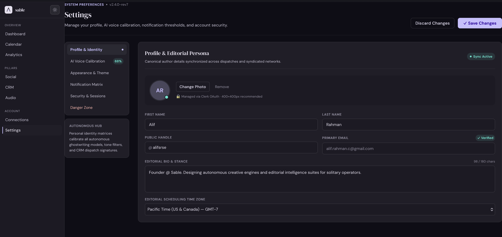

# sable

**What you learn becomes what you say.**

An autonomous editorial intelligence suite for solitary operators, founders, and thinkers — connecting audio intelligence, social publishing, and relationship management into a single compounding flywheel.

[](https://nextjs.org)
[](https://www.typescriptlang.org)
[](https://clerk.com)
[](https://prisma.io)
[](https://tailwindcss.com)

</div>

---

## Overview

Sable is a private editorial intelligence platform built for the high-conviction solo operator. It replaces the fragmented stack of Buffer, HubSpot, and Pocket Casts with a unified autonomous flywheel:

- **Social Studio** — AI voice persona calibrated to your lexical density and stance, drafting multi-platform dispatches across LinkedIn, X, and Substack
- **Smart CRM** — Relationship intelligence that tracks contact health, suggests personalised follow-ups in your voice, and converts social commenters into pipeline
- **Audio Studio** — Podcast and voice memo transcription, atomic insight extraction, and one-click audio-to-dispatch transformation

Every pillar feeds the others. What you hear fuels what you publish. Your engagement deepens your relationships. The flywheel compounds continuously.

---

## Screenshots

<div align="center">

**Editorial Dashboard**


<br/>

**Social Studio — Calendar & Dispatch Queue**


<br/>

**Smart CRM — Relationship Intelligence**


<br/>

**Analytics — Resonance & Reach**


<br/>

**AI Voice Settings**


</div>

---

## Tech Stack

| Layer | Technology |
|---|---|
| Framework | Next.js 15 App Router |
| Language | TypeScript |
| Auth | Clerk |
| Database | Prisma ORM |
| Styling | CSS Variables + Design System (dark/light themes) |
| Typography | DM Serif Display + DM Sans |
| Fonts | Google Fonts |

---

## Getting Started

### Prerequisites

- Node.js 18+
- A Clerk account (for auth)
- A database compatible with Prisma (PostgreSQL recommended)

### Installation

```bash
git clone https://github.com/yourusername/sable.git
cd sable
npm install
```

### Environment Variables

Create a `.env.local` file in the root:

```env
NEXT_PUBLIC_CLERK_PUBLISHABLE_KEY=pk_...
CLERK_SECRET_KEY=sk_...
NEXT_PUBLIC_CLERK_SIGN_IN_URL=/sign-in
NEXT_PUBLIC_CLERK_SIGN_UP_URL=/sign-up
DATABASE_URL=postgresql://...
```

### Run

```bash
npx prisma generate
npx prisma db push
npm run dev
```

Open [http://localhost:3000](http://localhost:3000).

---

## Project Structure

```
sable/
├── app/
│   ├── (app)/              # Authenticated app routes
│   │   ├── dashboard/      # Editorial console
│   │   ├── analytics/      # Resonance & reach metrics
│   │   ├── calendar/       # Dispatch queue & scheduling
│   │   ├── connections/    # CRM & social connections
│   │   └── settings/       # AI voice, appearance, notifications
│   ├── sign-in/            # Clerk auth
│   └── sign-up/
├── components/             # Shared UI components
├── lib/                    # Utilities
├── prisma/                 # Database schema
├── docs/                   # Marketing landing page
└── server/                 # Server-side logic
```

---

## Design System

Sable uses a custom CSS variable design system with two themes:

- **Obsidian Dark** (default) — deep violet-tinted darks with accent violet `#7C6AF7`, teal `#2DD4BF`, and coral `#F4845F`
- **Daylight Editorial** — clean off-whites with adapted accent palette

Toggle between themes from the nav bar or Settings → Appearance.

---

## License

Private. All rights reserved — Sable Technologies, Inc. © 2026.

---

<div align="center">

Built with intention for high-resonance operators.

</div>
